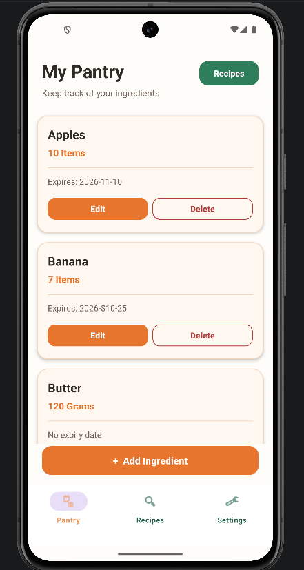
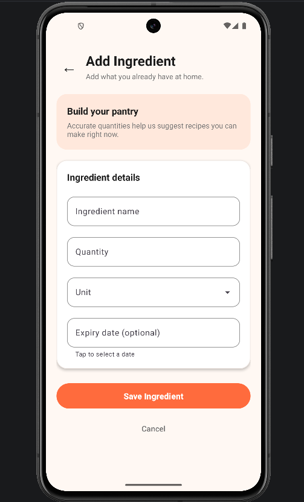
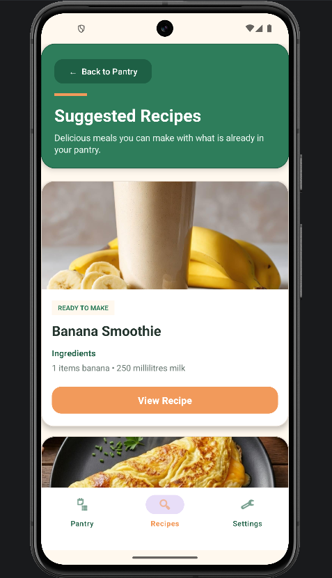
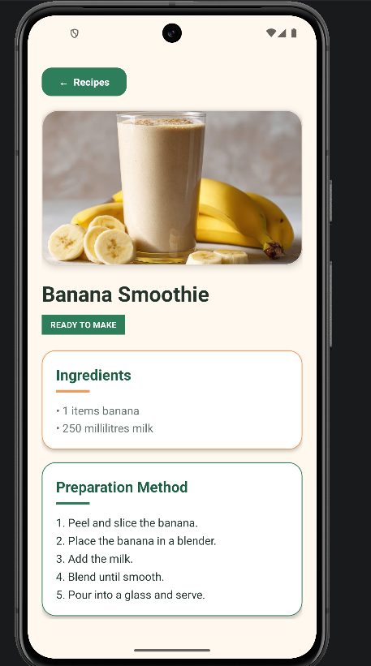
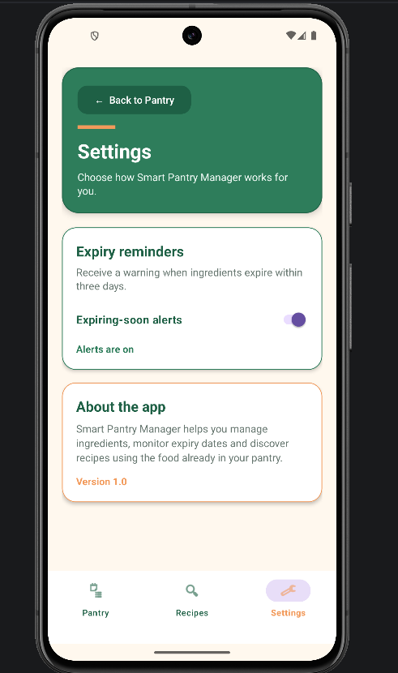

# Smart Pantry Manager 

Smart Pantry Manager is an Android application that helps users manage pantry ingredients, monitor expiry dates
and discover recipes they can prepare using ingredients they already have.

The application was developed in Java using Android Studio and SQLite.

# Features 

- Add new pantry ingredients 
- Display ingredients using RecycleView cards
- Edit existing ingredients 
- Delete ingredients with confirmation 
- Store ingredient name, quantity, unit and expiry date
- Save pantry information using SQLite
- Select expiry dates using a DatePicker 
- Warn users about ingredients expiring within three days 
- Enable or disable expiry alerts in Settings 
- Save user preferences using SharedPreferences 
- Display preloaded recipes with meal images 
- Suggest recipes only when all required ingredients are available 
- Check whether ingredient quantities are sufficient 
- Support basic singular, plural and unit normalization
- Display complete recipe ingredients and preparation instructions
- Provide bottom navigation between Pantry, Recipes and Settings 
- Display helpful feedback when no recipes match the pantry 

## Recipe Matching 

The application uses strict recipe matching 

A recipe is suggested only when:

1. Every required ingredient exists in the pantry 
2. The available quantity is equal to or greater than the required quantity 
3. The pantry unit is compatible with the recipe unit. 

For example, Grilled cheese will only appear when the pantry contains enough bread slices, cheese and butter.

## Technologies used 

- Java
- Android Studio 
- Android SDK
- SQLite and SQLiteOpenHelper
- RecyclerView
- Material Design components 
- SharedPreferences 
- Git and GitHub 

## Main Screens 

## Screenshots

### Pantry and Ingredient Management

| Pantry Screen | Add Ingredient Screen |
|---|---|
|  |  |

### Recipe Suggestions and Details

| Suggested Recipes | Recipe Details |
|---|---|
|  |  |

### Settings

| Settings Screen |
|---|
|  |

### Pantry 

Displays all saved pantry ingredients and allows users to add, edit or delete items.

### Add or Edit Ingredient 

Allows the user to enter an ingredient name, quantity, unit and optional expiry date.

## Suggested Recipes 

Displays recipes that can be prepared using the ingredients and quantities currently available in the pantry.

### Recipe Details 

Displays the selected meal image, required ingredients and preparation instructions. 

### Settings 

Allows the user to enable or disable expiring-soon alerts 

### Database Structure 

The application uses three SQLite tables:

- 'pantry_items' - stores the users pantry ingredients.
- 'recipes' - stores recipe names, instructions and image name.
- 'recipe_ingredients' - stores the ingredients and quantities required by each recipe. 

The recipes are inserted only when necessary to prevent duplicate recipe records when the application is reponed.

## How to run the app

1. Clone or download this repository.
2. Open the project in Android Studio 
3. Allow Gradle to finish synchronizing 
4. Start an Android emulator or connect an Android device.
5. Press **Run** to install and open the application 

## Testing 

The application was manually tested for:

- Adding, viewing, updating and deleting ingredients 
- SQLite data persistence after restarting the application 
- Input validation
- Missing recipe ingredients 
- Insufficient ingredient quantities 
- Compatible recipe units 
- Recipe details and images 
- Empty recipe results 
- Expiry warnings
- Settings persistence
- Navigation between screens

## Future improvements

Possible future improvements would include:

- Notifications that work when the app is closed
- Link to a YouTube video on how to prepare a recipe 
- Voice assistance to read out the steps of the recipe
- User-selected reminder periods 
- Recipe search and filtering 
- Customer user-created recipe 
- Cloud backup and account synchronization 
- Barcode scanning for pantry items 

## Developer 

Developed by **Siyabonga Ntshingila** as a Mobile App Development project. 

